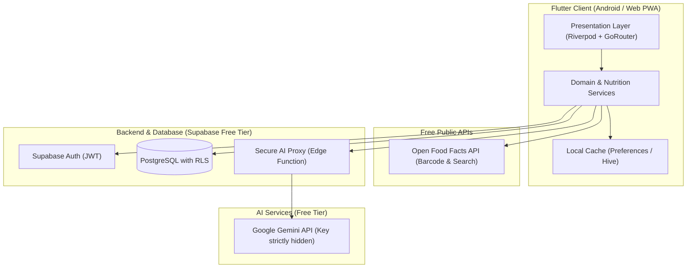
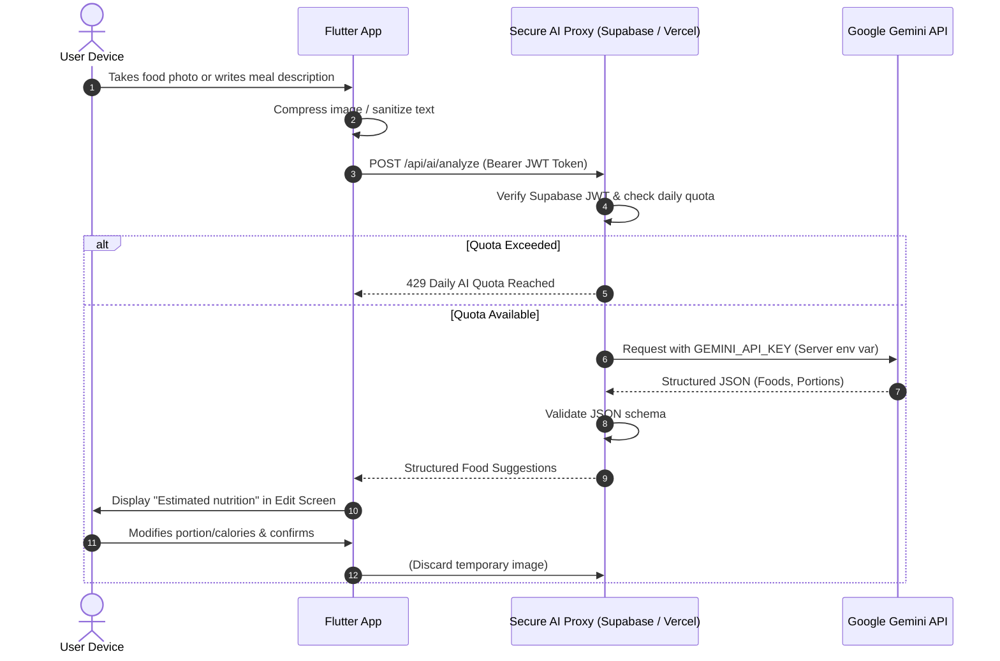
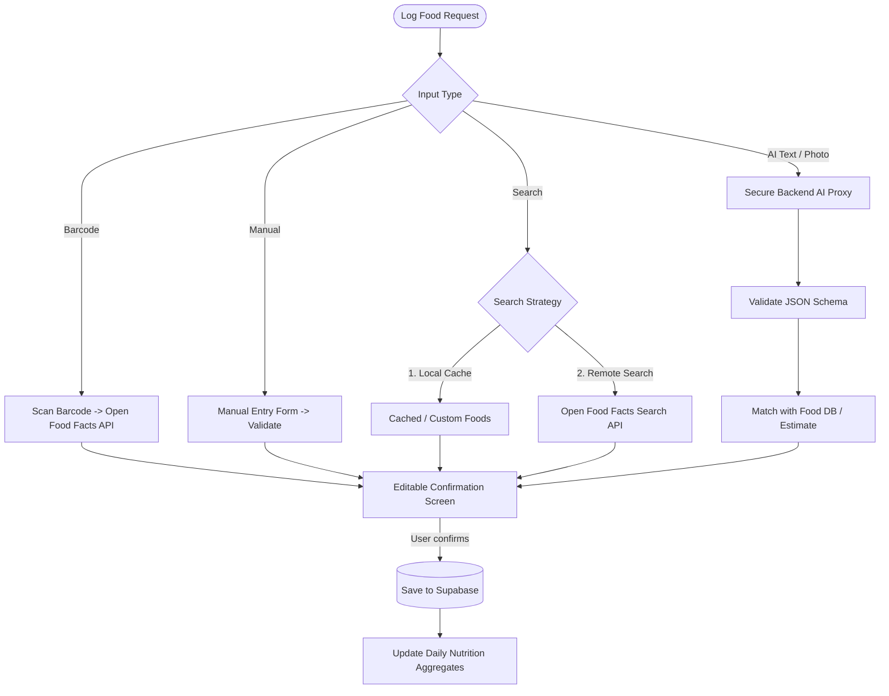
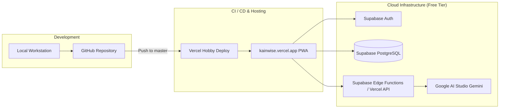

# KainWise — Architecture & System Design Document

## 1. Executive Summary & Philosophy
KainWise is a simple, modern, zero-cost AI-assisted calorie and macronutrient tracking application built with Flutter.
The core product tenet is:
> **"AI assists. The user confirms."**

AI is strictly reserved for high-friction logging tasks (food image recognition, natural language meal parsing, conversational assistance), while deterministic nutrition databases, barcode lookups, and local calculations handle core nutrition computations.

---

## 2. Zero-Cost Technology Stack

| Layer | Technology | Free Tier Justification & Pricing Protection |
| :--- | :--- | :--- |
| **Frontend Framework** | Flutter 3.47+ (Dart 3.13+) | Open source, multi-platform (Android, Web/PWA, iOS). |
| **State Management** | Flutter Riverpod | Open source, reactive, compile-safe dependency injection. |
| **Routing** | GoRouter | Open source, declarative, deep-link & web history ready. |
| **Database & Auth** | Supabase (PostgreSQL + GoTrue) | Free tier: 500MB DB, 50,000 monthly active users, full RLS. |
| **AI Backend Gateway** | Supabase Edge Functions / Vercel Serverless | Free tier: 500k invocations/mo (Supabase) or 100k/mo (Vercel). Protects API keys. |
| **AI Model Engine** | Google Gemini Free Tier (`gemini-2.5-flash` / `gemini-1.5-flash`) | Free tier via Google AI Studio (up to 15 RPM, zero cost). |
| **Nutrition & Barcodes**| Open Food Facts API | Free, open crowd-sourced database, no API key required. |
| **Local Cache / Storage** | SharedPreferences / Hive | Free, client-side, zero infrastructure cost. |
| **Data Visualization** | `fl_chart` | Free, high-performance Flutter charting library. |
| **Camera & Barcode** | `mobile_scanner`, `image_picker` | Open source, on-device hardware access. |
| **Hosting & CI/CD** | Vercel Hobby + GitHub Actions | Free hobby hosting for Flutter Web/PWA with SSL. |

---

## 3. High-Level Architecture Diagram



---

## 4. Frontend Architecture & Directory Layout

The application adopts a feature-first clean architecture:

```
lib/
├── app/
│   ├── app.dart               # Root MaterialApp with theme & router
│   ├── router.dart            # GoRouter configuration & auth guards
│   └── theme/
│       ├── app_colors.dart    # Clean health/nutrition palette
│       ├── app_theme.dart     # Light theme system & typography
│       └── app_typography.dart
├── core/
│   ├── constants/             # App constants, limits, meal types
│   ├── errors/                # Failure & exception classes
│   ├── network/               # Dio/HTTP client configurations
│   ├── utils/                 # Unit conversions, date formatters
│   └── widgets/               # Reusable buttons, inputs, cards, state views
├── features/
│   ├── auth/                  # Login, Register, Forgot Password
│   ├── onboarding/            # Profile setup, TDEE & macro calculations
│   ├── dashboard/             # Calorie summary, ring progress, meal summary
│   ├── diary/                 # Daily meal timeline, date navigation
│   ├── food_logging/          # Manual, Search, Barcode, AI Text/Photo, Voice
│   ├── progress/              # Charts, weight tracking, weekly trends
│   ├── assistant/             # AI Calorie Assistant (chat interface)
│   └── profile/               # User settings, goals edit, account
└── services/
    ├── supabase/              # Supabase client, session listener
    ├── nutrition/             # Calorie & macro calculation formulas
    ├── barcode/               # Open Food Facts barcode client
    └── ai/                    # AI proxy client (calls backend endpoint)
```

---

## 5. Security Architecture & API Key Isolation



### Critical Security Rules:
1. **Never embed `GEMINI_API_KEY` in Flutter source code or web bundle.**
2. **All AI calls route through a authenticated backend proxy.**
3. **Database access guarded by PostgreSQL Row Level Security (RLS)** — users can only SELECT, INSERT, UPDATE, DELETE their own data linked to `auth.uid()`.
4. **Temporary Images Only:** Food images are compressed client-side, sent ephemerally to the backend for analysis, and never permanently stored in cloud buckets to eliminate storage costs and protect user privacy.

---

## 6. Nutrition Data Strategy & Calculation Pipeline



### Nutrition Calculation Formulas:
- **BMR (Mifflin-St Jeor):**
  - Male: $10 \times \text{weight (kg)} + 6.25 \times \text{height (cm)} - 5 \times \text{age} + 5$
  - Female: $10 \times \text{weight (kg)} + 6.25 \times \text{height (cm)} - 5 \times \text{age} - 161$
- **TDEE:** $\text{BMR} \times \text{Activity Multiplier}$ (Sedentary: 1.2, Light: 1.375, Moderate: 1.55, Very: 1.725)
- **Goal Adjustments:**
  - Lose Weight: TDEE - 500 kcal (approx. 0.5 kg/week)
  - Maintain Weight: TDEE
  - Gain Weight: TDEE + 300 to 500 kcal
- **Remaining Calories:**
  $$\text{remainingCalories} = \text{calorieGoal} - \text{caloriesConsumed}$$

---

## 7. Zero-Cost Protection: Quota & Fallback Matrix

| Feature | Daily Free Limit | Fallback Behavior on Limit/Failure |
| :--- | :--- | :--- |
| **Photo Food AI** | 10 scans / day | Prompts user to use Barcode or Manual Entry |
| **AI Text Logging** | 20 logs / day | Fallback to Food Search or Manual Entry |
| **AI Assistant Chat** | 20 messages / day | Provides static tips & links to Diary/Progress |
| **Barcode Scan** | **Unlimited** (Open Food Facts) | Manual fallback if product not in database |
| **Food Search** | **Unlimited** (Within public rate limits)| Custom food creation |
| **Manual Logging** | **Unlimited** | Always operational |

---

## 8. Deployment Architecture



- **Web Deployment:** Flutter Web compiled as single-page PWA and served via Vercel Hobby static hosting.
- **Android Deployment:** Standard Flutter Android APK / App Bundle generation for direct sideload or internal testing.
- **Backend Deployment:** Supabase CLI migrations & Edge Functions deployed to free Supabase project, or Vercel serverless functions in `/api`.
