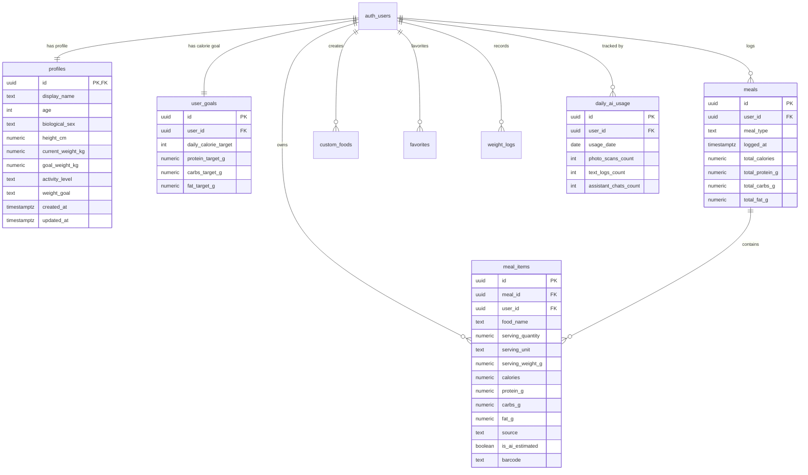

# KainWise — Database Architecture & Security Specification

## 1. Overview
The KainWise persistence layer runs entirely on **Supabase PostgreSQL Free Tier**.
Zero cost is guaranteed through:
- Strict relational constraints and normalized tables (minimizing storage well below 500 MB).
- Database-level Row Level Security (RLS) enforcing that every query is partitioned by `auth.uid()`.
- Client and Edge functions running under user JWT context.

---

## 2. Entity-Relationship Model

---

## 3. Schema & Constraints Summary

| Table | Primary Key | Foreign Key | Key Constraints | Purpose |
| :--- | :--- | :--- | :--- | :--- |
| `profiles` | `id` (uuid) | `auth.users(id)` | `CASCADE` on delete, age $\ge 10$ | Stores onboarding, biometrics, and activity level. |
| `user_goals` | `id` (uuid) | `auth.users(id)` | `UNIQUE(user_id)`, target 800–10,000 kcal | Active target calories and macronutrient breakdown. |
| `meals` | `id` (uuid) | `auth.users(id)` | `meal_type` enum, indexed on `(user_id, logged_at)` | High-level meal group (Breakfast, Lunch, etc.). |
| `meal_items` | `id` (uuid) | `meals(id)`, `auth.users(id)` | `CASCADE` on meal delete, non-negative nutrition | Granular food items within a meal. |
| `custom_foods`| `id` (uuid) | `auth.users(id)` | Indexed on `user_id` | User-defined custom foods and home recipes. |
| `favorites` | `id` (uuid) | `auth.users(id)` | Indexed on `user_id` | Quick-log shortcut for frequent meals and foods. |
| `weight_logs` | `id` (uuid) | `auth.users(id)` | `UNIQUE(user_id, logged_at)` | Weigh-in timeline for weight trend tracking. |
| `daily_ai_usage`| `id` (uuid)| `auth.users(id)` | `UNIQUE(user_id, usage_date)` | Enforces zero-cost daily AI quotas. |

---

## 4. Row Level Security (RLS) Matrix

RLS is enabled unconditionally on all tables:

| Operation | Policy Expression | Security Check |
| :--- | :--- | :--- |
| **SELECT** | `auth.uid() = user_id` | Prevents User A from reading User B's meals or biometrics. |
| **INSERT** | `auth.uid() = user_id` | Prevents spoofing records under another user's UUID. |
| **UPDATE** | `auth.uid() = user_id` | Guarantees users can only modify their own entries. |
| **DELETE** | `auth.uid() = user_id` | Guarantees users can only delete their own records. |

---

## 5. Automated Triggers
- `on_auth_user_created`: When a new user registers via Supabase Auth, PostgreSQL automatically creates a matching entry in `public.profiles` using the user's metadata `display_name`.
